# Website visual polish — 15 November 2026 (Sydney)

## Scope and source

Visual branch starts at website `dc12b22`. All visible words in all eight `pages/*.html` remain unchanged. `COPY` comments mark captions/labels for Claude. Feature/version/hash updates belong to the separate copy branch.

Removed the three October 29 screenshots from the homepage and replaced simulated lesson/keyboard UI with actual production-component renders and current in-app `assets/photos/corrections/yawnSpace.jpg` artwork. Old screenshot files remain unreferenced for history. No generated or invented UI is used.

The lane is the production `src/exercise/NoteLaneCanvas.tsx` tree, rendered at 360 × 420 logical units / 2× density. Ready Check uses production `src/exercise/warmups/ReadyCheckCanvas.tsx`, at 360 × 168 / 2× density. The component entry sources are unchanged against release `04eed9fb`. Exact synthetic props, input files and hashes are in `component-source/*manifest.json`. Font: the app's Inter-Regular; `matchFont` uses its actual bundled bytes. CanvasKit CPU rendering does not establish native/GPU or installed APK parity.

The repository's existing Ready Check exporter failed closed on a newer `soundMatch` dependency. Its allowlist was not changed. Instead these review-only scripts bundle the actual source with esbuild, then draw the production Skia children using the repo's installed headless reconciler. For the lane only, React hooks are evaluated synchronously and Reanimated values are frozen to documented fixture inputs; this renders one static component state, not animation or native layout. Resource surfaces/images/reconciler are disposed. This one-off renderer does not claim the guarded exporter's runtime/cleanup guarantees.

Reproduce from the app repo with installed Skia/CanvasKit and esbuild:

```sh
mkdir -p tmp/web-component-render
# Copy render.cjs, render-lane.cjs and compress.cjs from component-source here first.
npx esbuild src/exercise/warmups/ReadyCheckCanvas.tsx --bundle --platform=node --format=cjs --external:react --external:react-native --external:@shopify/react-native-skia --outfile=tmp/web-component-render/ready.cjs --metafile=tmp/web-component-render/inputs.json
npx esbuild src/exercise/NoteLaneCanvas.tsx --bundle --platform=node --format=cjs --external:react --external:react-native --external:react-native-reanimated --external:@shopify/react-native-skia --external:*.png --external:*.ttf --outfile=tmp/web-component-render/lane.cjs --metafile=tmp/web-component-render/lane-inputs.json
node tmp/web-component-render/render.cjs
node tmp/web-component-render/render-lane.cjs
```

`compress.cjs` documents WebP encoding via browser canvas; adjust its local Playwright and output-worktree paths. It only scales/encodes existing artwork and component renders. It does not draw UI.

## Validation

- All 8 pages, widths 360 / 412 / 1440, text at 100% and 200%: no horizontal overflow or broken images (48 cases).
- Reduced-motion: no animated elements on all pages; smooth scrolling disabled. Before: homepage had an animated element under reduced motion.
- Visible links, buttons and summaries: browser-computed keyboard focus rings present. Mobile menu opens and Escape closes it and returns focus.
- Contrast script: eight existing ink/face checks pass, minimum 5.24:1. New brass heading darkest stop `#b48d4e` on black is above AA for large text. Forced-colors restores solid system text and outlines. No comprehensive WCAG certification claimed.
- `python3 build.py`, JS syntax checks, `git diff --check`, and source-page visible-text comparison against `dc12b22`: pass.
- Conservative cold homepage budget: images 128,486 bytes; HTML/CSS/JS 61,874; fonts 1,440,324; total 1.631 MB. Four replacement images total about 32 KB. Font payload is unchanged.
- App lint / tsc / vitest: not run for this static website change; no app source changed.

## Device limitation / merge coordination

ADB inventory and mDNS discovery were empty. No S25 capture, install or versionCode readback was possible. The lane render does **not** show the surrounding brass title, condensed tips, microphone widget, or paused picture overlay. A full release capture must still verify those before claiming a complete current-screen audit. No app PR or `next-build-ui.json` entry is created by this website branch; the brief's app success criteria belong to the app/build owner.

Merge copy first, then rebase this branch and rerun `python3 build.py`, preserving both sets of `pages/index.html` edits. Do not deploy or merge from this review. Existing copy still needs Claude's captions and latest release metadata.

## Before / after

Screenshots are full-page browser captures, with remote APK API blocked in both phases for reproducibility. “Before” is `dc12b22`. Root HTML for every page changes because the shared asset revision and demo-script removal are regenerated. Links below cover each affected page; 412px and 1440px captures are beside these files.

### index

| Before · 360px | After · 360px |
| --- | --- |
|  |  |

[412px before](before-index-412.webp) · [412px after](after-index-412.webp) · [Desktop before](before-index-1440.webp) · [Desktop after](after-index-1440.webp)

### features

| Before · 360px | After · 360px |
| --- | --- |
| 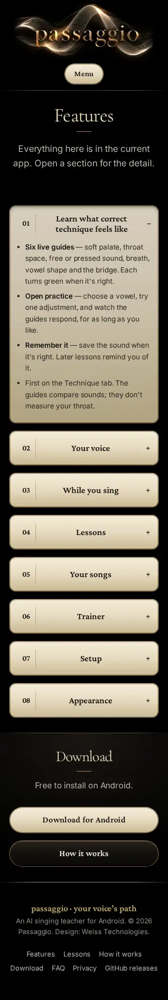 | 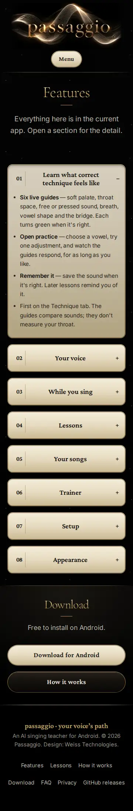 |

[412px before](before-features-412.webp) · [412px after](after-features-412.webp) · [Desktop before](before-features-1440.webp) · [Desktop after](after-features-1440.webp)

### lessons

| Before · 360px | After · 360px |
| --- | --- |
| 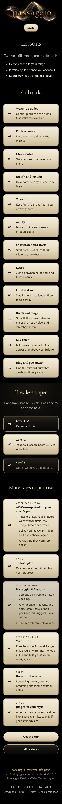 | 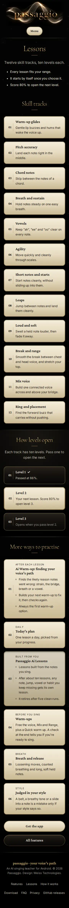 |

[412px before](before-lessons-412.webp) · [412px after](after-lessons-412.webp) · [Desktop before](before-lessons-1440.webp) · [Desktop after](after-lessons-1440.webp)

### how-it-works

| Before · 360px | After · 360px |
| --- | --- |
| 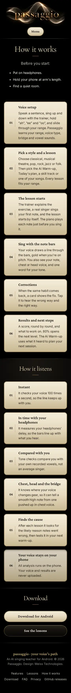 | 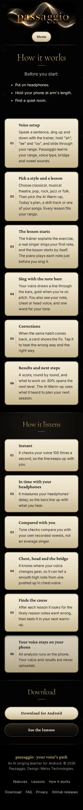 |

[412px before](before-how-it-works-412.webp) · [412px after](after-how-it-works-412.webp) · [Desktop before](before-how-it-works-1440.webp) · [Desktop after](after-how-it-works-1440.webp)

### faq

| Before · 360px | After · 360px |
| --- | --- |
|  | 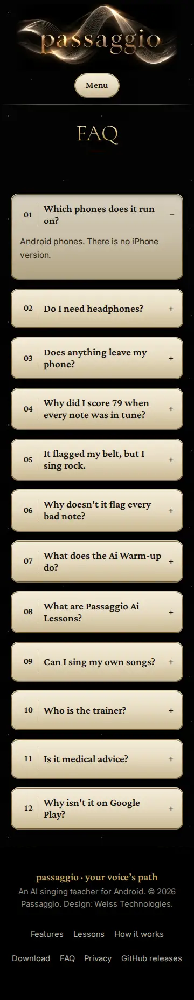 |

[412px before](before-faq-412.webp) · [412px after](after-faq-412.webp) · [Desktop before](before-faq-1440.webp) · [Desktop after](after-faq-1440.webp)

### download

| Before · 360px | After · 360px |
| --- | --- |
| 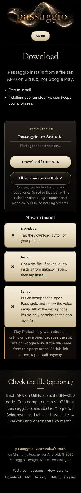 | 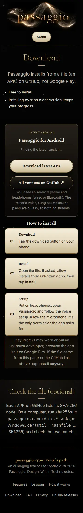 |

[412px before](before-download-412.webp) · [412px after](after-download-412.webp) · [Desktop before](before-download-1440.webp) · [Desktop after](after-download-1440.webp)

### privacy

| Before · 360px | After · 360px |
| --- | --- |
|  | 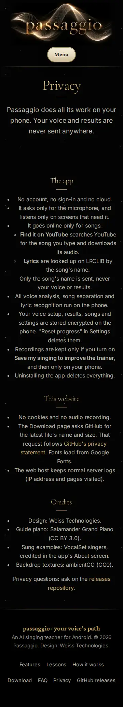 |

[412px before](before-privacy-412.webp) · [412px after](after-privacy-412.webp) · [Desktop before](before-privacy-1440.webp) · [Desktop after](after-privacy-1440.webp)

### 404

| Before · 360px | After · 360px |
| --- | --- |
| 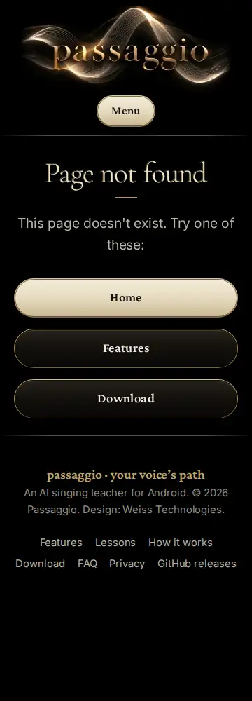 | 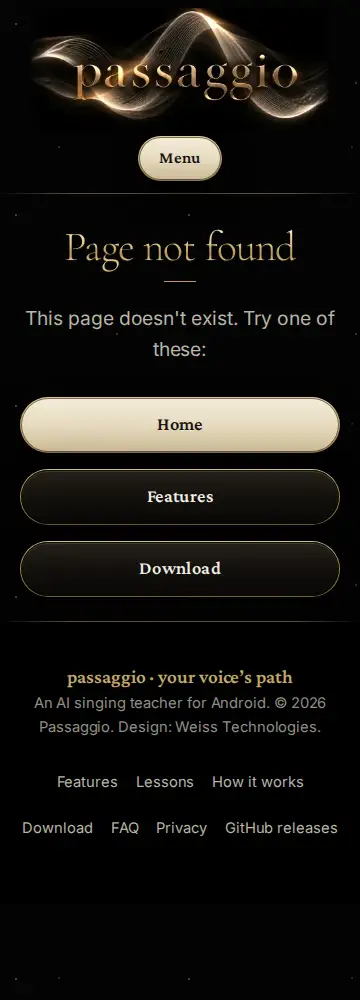 |

[412px before](before-404-412.webp) · [412px after](after-404-412.webp) · [Desktop before](before-404-1440.webp) · [Desktop after](after-404-1440.webp)
